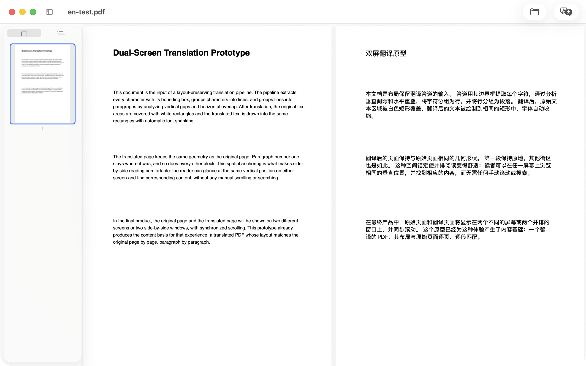
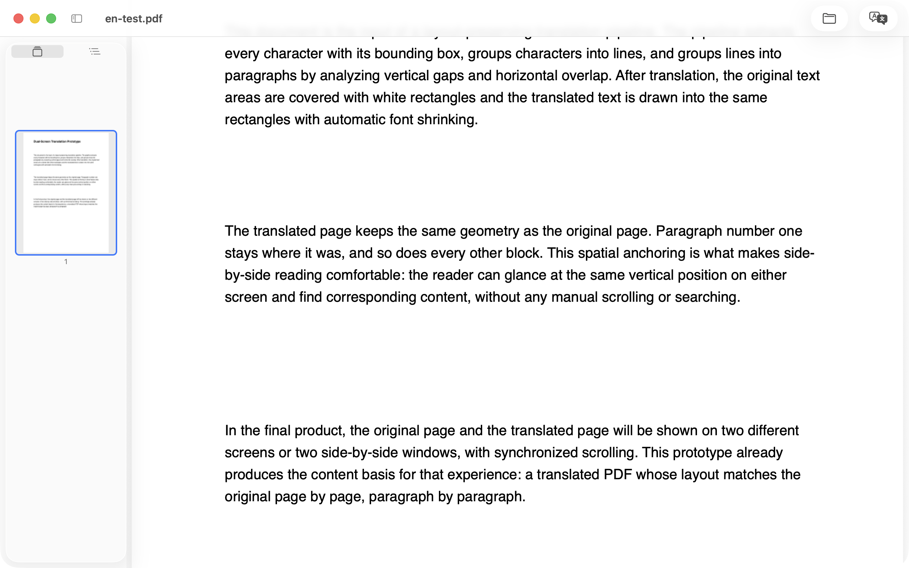

# KenjaPDF

**A minimal PDF reader that translates** — drop in a document, tap once, and read the original side by side with its translation. On-device, layout-preserving, private by default.

*Any PDF, in your own language.*

  

<em>Original and translation, side by side — scrolling in sync, translated entirely on device.</em>

**[Website](https://kenjapdf.kofukuai.com/) · [中文官网](https://kenjapdf.kofukuai.com/zh.html) · [Privacy Policy](privacy.md) · [Support](https://github.com/KenjaHub/KenjaPDF/issues)**

**Coming soon to the Mac App Store.**

---

KenjaPDF does two things and does them well: **a clean, minimal PDF reader** and **side-by-side bilingual translation**. It's a native Mac tool, private by default — no accounts, no analytics, no tracking, and documents never leave your machine.

> "Kenja" is Japanese for *sage* — the wise one. Building smarter software is the mission.

## How it works

| | |
|---|---|
| **Read** | Drag a PDF onto the window (or ⌘O). Continuous scrolling, thumbnails and outline in a collapsible sidebar, free zoom, page labels, printing (⌘P) — password-protected files unlock with a prompt. |
| **Translate** | Pick a language pair — the source is auto-detected — and press Translate. Apple's on-device engine translates the whole document; the result opens beside the original, scrolling in sync. One button cycles side-by-side, translation-only and original-only. |
| **Export** | Export a translation-only PDF, or an alternating bilingual edition (original page, translated page). |

## Highlights

- **On-device translation** — Apple's system translation engine runs right on your Mac. Documents are never uploaded; the first translation of a language pair may download a small pack, managed by macOS.
- **20+ languages, auto-detected** — the source language is recognized automatically (or picked manually), the target defaults to your system language, and the supported list comes straight from macOS.
- **Side by side, in lockstep** — original and translation scroll together in both directions; zoom mirrors between panes.
- **The page stays the page** — each translated paragraph is drawn back into its original rectangle; geometry, margins and vector graphics stay intact.
- **Formulas stay formulas** — math-heavy lines (LaTeX, MathType, Cambria Math) are detected and left untouched while the prose around them translates. Built for papers and theses.
- **Private by default** — no accounts, no API keys, no telemetry. App Store privacy label: Data Not Collected.

## Requirements

macOS 26 or later for on-device translation (Apple's Translation framework). Reading, outline and export run on macOS 13 and later.

## FAQ

**Does KenjaPDF upload my documents anywhere?**
No. Reading, layout analysis and translation all run on your Mac, using Apple's on-device system engine.

**Which languages are supported?**
20+ target languages via macOS system translation. The source is auto-detected or picked manually; the target defaults to your system language.

**Do I need an account or API key?**
No. Translation uses the engine built into macOS — no sign-in, no keys, no subscriptions.

**Does it work with scanned PDFs?**
KenjaPDF translates the text layer; image-only scans are not translatable in this version — run OCR first.

## Website (this repository)

The product site lives in [`docs/`](docs/) and is served by GitHub Pages at <https://kenjapdf.kofukuai.com> (custom domain via `docs/CNAME`; EN at `index.html`, 简体中文 at `zh.html`, privacy at `privacy.html`, plus `robots.txt` and `sitemap.xml`).

Publishing notes:

- GitHub Pages: deploy from branch `main`, folder `/docs` (repo Settings → Pages).
- DNS: `kenjapdf.kofukuai.com` CNAME → `KenjaHub.github.io`.
- When the app goes live on the App Store, replace the "Coming soon" CTA in `index.html` / `zh.html` with the App Store badge (see KenjaSub-Site for the pattern).
- Add a Google Search Console verification file to `docs/` when claiming the domain.

## 中文介绍

**KenjaPDF 是一款 Mac 双语对照 PDF 阅读器**：极简阅读 + 一键本地翻译。拖入文档，点一下，原文译文双栏对照——滚动同步、版式保留，翻译全部在设备本地完成。

Kenja 在日语中意为「智者」（sage）——这也是我们的目标：开发更聪明的软件。

### 两步，一个安静的窗口

- **阅读** —— PDF 拖进窗口即开（或 ⌘O）。连续滚动、可收起侧栏（缩略图 + 大纲）、自由缩放、页码标签、打印 ⌘P；加密 PDF 输入密码即解锁。
- **翻译** —— 选语言对（源语言自动检测）点「翻译」，Apple 系统引擎在本地翻译整篇文档，译文与原文双栏同步滚动；一个按钮切换双栏 / 只看译文 / 只看原文。
- **导出** —— 纯译文 PDF，或原文 / 译文逐页交替的双语对照版。

### 特色

- **翻译完全本地** —— Apple 系统引擎在设备上运行，文档零上传
- **20+ 种语言** —— 源语言自动识别，目标语言跟随系统
- **双栏步调一致** —— 双向同步滚动，缩放镜像跟随
- **版式保留** —— 译文逐段画回原位置，页边距与矢量图不动
- **公式保护** —— 数学行自动识别、原样保留，论文文献友好
- **默认保护隐私** —— 无账号、无 Key、无遥测，App Store 隐私标签「不收集数据」

### 系统要求

翻译需 macOS 26 或更高版本（Apple 翻译框架）；阅读、大纲与导出支持 macOS 13+。

**[中文官网](https://kenjapdf.kofukuai.com/zh.html) · [隐私政策](https://kenjapdf.kofukuai.com/privacy.html) · [支持 / 反馈](https://github.com/KenjaHub/KenjaPDF/issues)**

---

© 2026 KenjaHub · [Privacy Policy](privacy.md) · [kenjasoft@kofukuai.com](mailto:kenjasoft@kofukuai.com)
